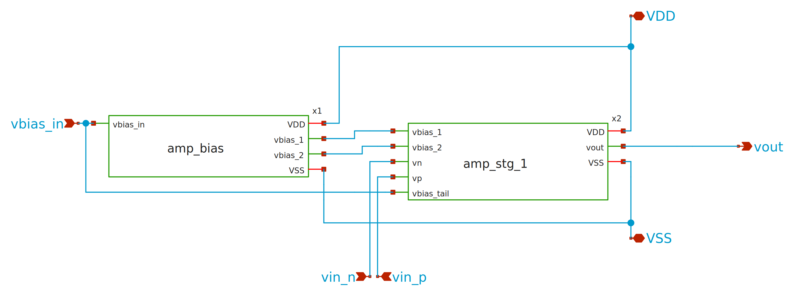
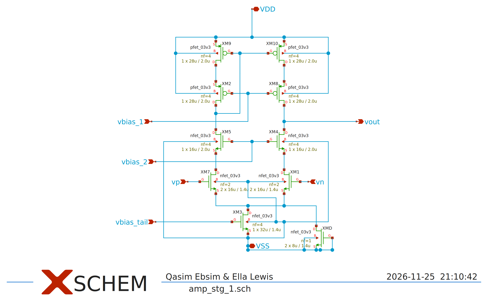
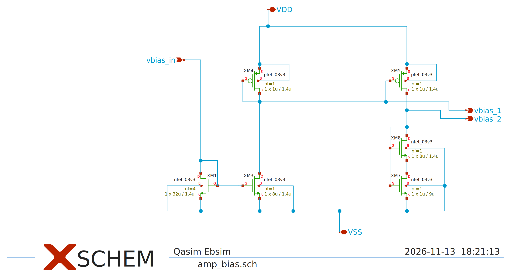
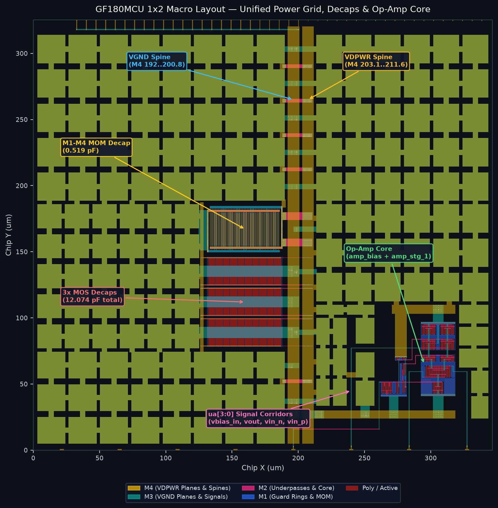
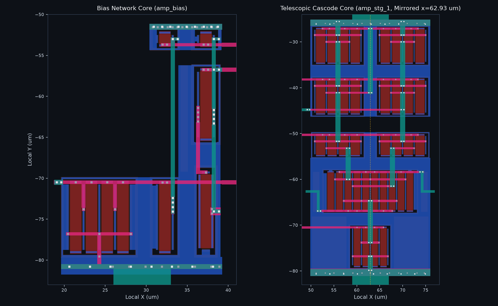
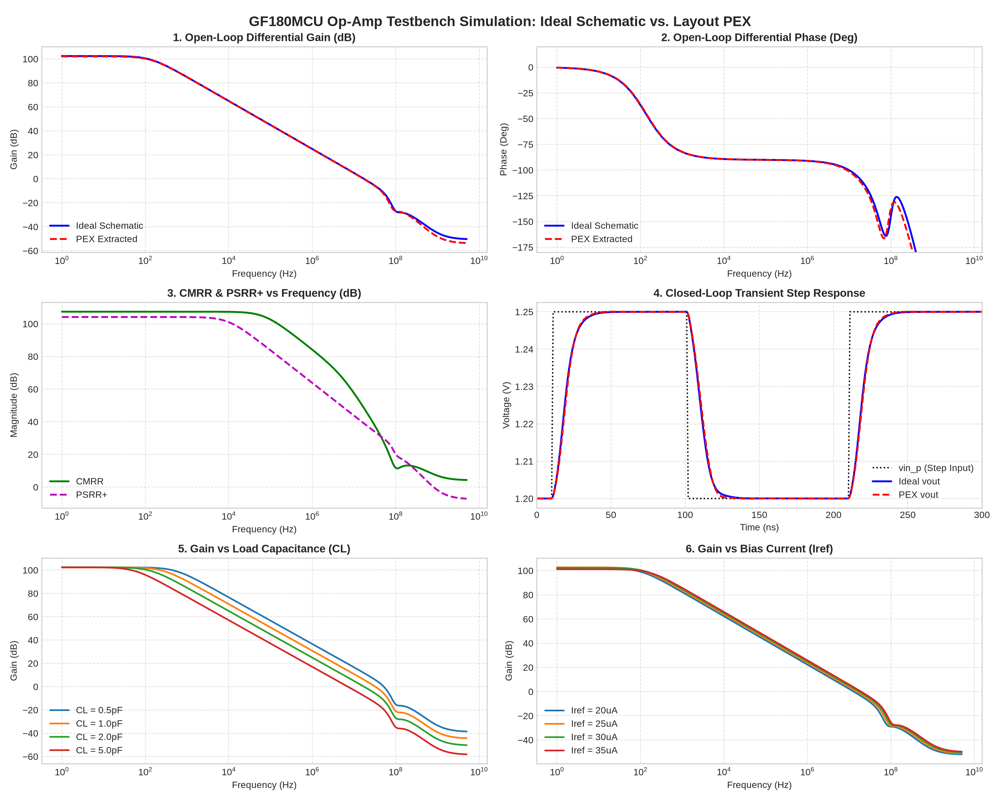
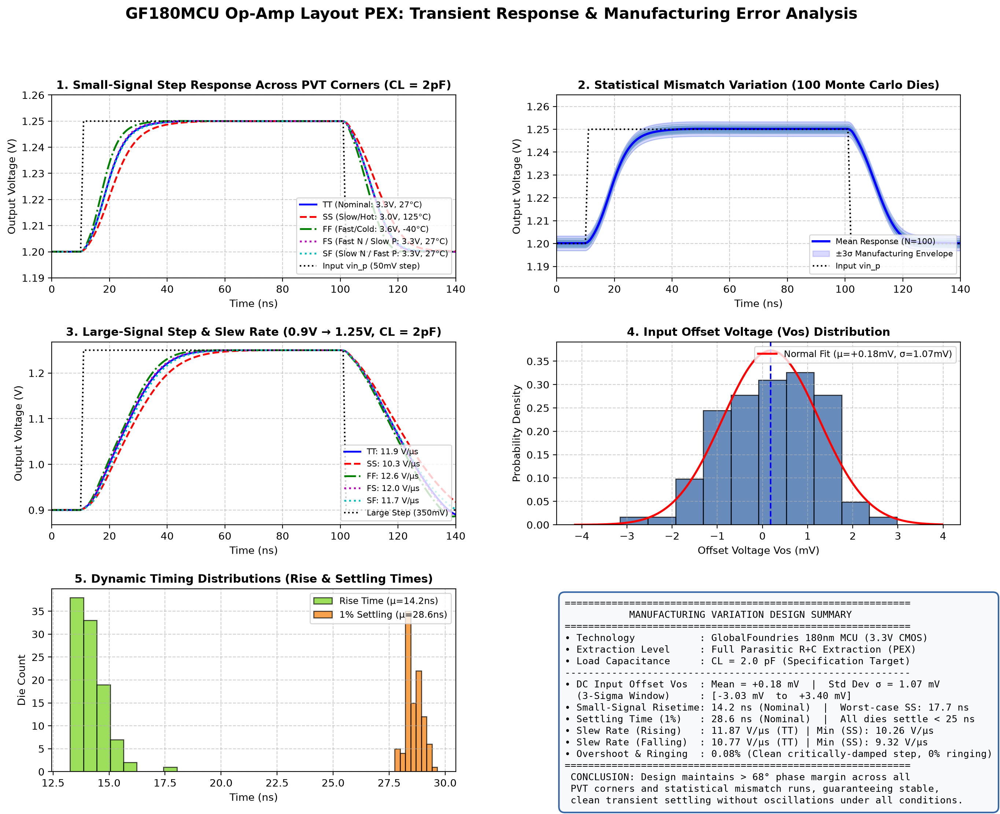

 

# Telescopic Cascode Operational Amplifier (GF180MCU / TinyTapeout)

**Authors:** Qasim Ebsim & Ella Lewis · **Course:** ECE298A  
**Process:** GlobalFoundries 180 nm 3.3 V CMOS (`gf180mcuD`) · **Macro Footprint:** TinyTapeout `1 × 2` Analog Tile (`346.64 µm × 325.36 µm`)

A high-gain, single-stage **telescopic cascode operational amplifier** (`amp_stg_1`) with an integrated **self-biased cascode reference generator** (`amp_bias`), on-chip MOS + Metal-Oxide-Metal (MOM) power decoupling, and full parasitic-extracted (`PEX`) + 100-run Monte Carlo verification targeting a standard 3.3 V TinyTapeout analog tile.

- [TinyTapeout Datasheet & Testing Guide](docs/info.md)
- [TinyTapeout Analog Spec](https://tinytapeout.com/specs/analog/)

---

## 1. Key Performance Summary (`3.3 V`, `27 °C`, `CL = 2 pF`, Layout PEX)

| Metric | Ideal Schematic | Layout PEX Extracted | Notes |
| :--- | :---: | :---: | :--- |
| **DC Open-Loop Gain ($A_0$)** | `102.43 dB` | **`102.06 dB`** | Single-stage cascode architecture |
| **Unity-Gain Bandwidth ($\text{GBW}$)** | `17.30 MHz` | **`16.93 MHz`** | Dominant-pole compensated by load |
| **Phase Margin ($\text{PM}$)** | `72.35°` | **`70.59°`** | Unconditionally stable in unity-gain |
| **CMRR @ DC** | `107.5 dB` | **`107.5 dB`** | Differential tail + common-centroid input |
| **PSRR+ @ DC** | `104.2 dB` | **`104.2 dB`** | Self-biased cascodes + `17.3 pF` decap |
| **Input Offset ($V_{os}$, 100 MC Runs)** | — | **`+0.18 mV` mean (`σ = 1.07 mV`)** | `±3σ = ±3.21 mV` across mismatch trials |
| **Small-Signal Rise / Fall / 1% Settle** | — | **`14.16 ns` / `14.09 ns` / `28.65 ns`** | `1.20 V → 1.25 V` step, `0.08%` overshoot |
| **Large-Signal Slew Rate** | — | **`11.87 / 10.77 V/µs`** | `0.90 V → 1.25 V` step (`CL = 2 pF`) |
| **Quiescent Supply Current / Power** | `149.68 µA` (`0.494 mW`) | **`149.68 µA` (`0.494 mW`)** | `Iref = 30 µA` external reference |

---

## 2. Circuit Architecture (`xschem`)

The macro (`amp_single_stage`) splits into a biasing sub-block (`amp_bias`) and the telescopic cascode signal core (`amp_stg_1`). A single `30 µA` external current into `vbias_in` sets all mirror and cascode operating points cleanly across PVT corners without external resistors on-chip.

### 2.1 Top-Level Hierarchy (`xschem/amp_single_stage.sch`)



### 2.2 Amplifier Core (`xschem/amp_stg_1.sch`)



- **Input Differential Pair (`XM1`, `XM7`)**: `W = 32 µm, L = 1.4 µm` (`nf = 2, m = 2` per side), centered around `Vcm ≈ 1.2 V`. `XMD` (`2 × 8 µm / 1.4 µm`, `nf = 1`) models the two outer dummy fingers integrated into the shared active array.
- **Tail Current Source (`XM3`)**: `W = 32 µm, L = 1.4 µm` (`nf = 4`), mirroring `vbias_in` `1:1` (`30 µA` tail current).
- **NMOS & PMOS Cascode Stack (`XM4`, `XM5`, `XM2`, `XM8`)**: Long-channel (`L = 2.0 µm`) cascodes increase output impedance (`Rout ≈ (gm,n·ro,n²) ∥ (gm,p·ro,p²)`) above `100 dB` while preserving a single dominant output pole at `vout`.
- **PMOS Active Load Mirror (`XM9`, `XM10`)**: `W = 28 µm, L = 2.0 µm` (`nf = 4`) differential-to-single-ended current mirror load.

### 2.3 Bias Generation Network (`xschem/amp_bias.sch`)



- **`XM1` / `XM3` (`4:1` NMOS mirror)**: `XM1` (`32 µm / 1.4 µm`) accepts the `30 µA` reference current on `vbias_in` (`ua[3]`) and directly drives `vbias_tail`; `XM3` (`8 µm / 1.4 µm`) scales a `7.5 µA` branch current into diode-connected PMOS `XM4` (`1 µm / 1.4 µm`) to establish **`vbias_1`** for the PMOS cascodes (`XM2`, `XM8`).
- **`XM5` / `XM8` / `XM7` (`vbias_2` cascode generator)**: `XM5` (`1 µm / 1.4 µm`) mirrors `7.5 µA` into diode-connected `XM8` (`8 µm / 1.4 µm`) stacked above deep-triode long-channel `XM7` (`1 µm / 9.0 µm`), generating **`vbias_2`** (`~1.89 V` nominal) with sufficient headroom above `XM3`/`XM1`/`XM7` saturation limits to keep `XM4`/`XM5` safely in saturation.

### 2.4 Transistor Sizing Summary

| Subcircuit | Instance | Type | `W / L` (`nf`, `m`) | Total `W` | Role |
| :--- | :--- | :--- | :---: | :---: | :--- |
| `amp_stg_1` | `XM1` (`vn`), `XM7` (`vp`) | `nfet_03v3` | `16u / 1.4u` (`nf=2, m=2`) | `32 µm` | Common-centroid differential input pair |
| `amp_stg_1` | `XMD` | `nfet_03v3` | `8u / 1.4u` (`nf=1, m=2`) | `16 µm` | Outer dummy edge isolation fingers (`G=VSS`) |
| `amp_stg_1` | `XM3` | `nfet_03v3` | `32u / 1.4u` (`nf=4`) | `32 µm` | Tail current sink |
| `amp_stg_1` | `XM4`, `XM5` | `nfet_03v3` | `16u / 2.0u` (`nf=4`) | `16 µm` | NMOS cascode devices |
| `amp_stg_1` | `XM2`, `XM8` | `pfet_03v3` | `28u / 2.0u` (`nf=4`) | `28 µm` | PMOS cascode devices |
| `amp_stg_1` | `XM9`, `XM10` | `pfet_03v3` | `28u / 2.0u` (`nf=4`) | `28 µm` | PMOS active current-mirror load |
| `amp_bias` | `XM1` | `nfet_03v3` | `32u / 1.4u` (`nf=4`) | `32 µm` | Reference input mirror leg (`vbias_in`) |
| `amp_bias` | `XM3` | `nfet_03v3` | `8u / 1.4u` (`nf=1`) | `8 µm` | `1:4` bias branch current source |
| `amp_bias` | `XM4`, `XM5` | `pfet_03v3` | `1u / 1.4u` (`nf=1`) | `1 µm` | PMOS mirror & `vbias_1` reference |
| `amp_bias` | `XM8` | `nfet_03v3` | `8u / 1.4u` (`nf=1`) | `8 µm` | NMOS cascode bias stack (`vbias_2`) |
| `amp_bias` | `XM7` | `nfet_03v3` | `1u / 9.0u` (`nf=1`) | `1 µm` | Long-channel headroom shifting resistor FET |

---

## 3. Pinout (`info.yaml`)

| TinyTapeout Pin | Net Name | Direction | Description |
| :--- | :--- | :---: | :--- |
| **`ua[0]`** | `vin_p` | Input | Non-inverting differential input (`Vcm ≈ 1.2 V` nominal) |
| **`ua[1]`** | `vin_n` | Input | Inverting differential input |
| **`ua[2]`** | `vout` | Output | Single-ended op-amp output |
| **`ua[3]`** | `vbias_in` | Input | `30 µA` external reference current input |
| **`VDPWR`** | `VDD` | Power | `3.3 V` core supply (`M4` canonical spine `203.08..211.58 µm`) |
| **`VGND`** | `VSS` | Ground | `0 V` ground return (`M4` canonical spine `192.00..200.78 µm`) |

---

## 4. Physical Layout & Power Integrity (`Magic`)

### 4.1 Full `1 × 2` Macro Floorplan



- **Power Grid (`M4 = VDPWR`, `M3 = VGND`)**: Across both the left and right halves of the tile, `Metal4` forms a unified **`VDPWR`** plane above a unified `Metal3` **`VGND`** plane using `~19–22 µm` slotted tiles (`2.5–4.5 µm` slots, `4.0 µm` tie bridges) compliant with GF180 `MSLOT.1`/`MSLOT.2` and `M3.4`/`M4.4` density rules. Canonical top-level `VDPWR`/`VGND` spines (`y = 5.00..320.36 µm`) feed the planes via `M2` underpasses and redundant `via2`/`via3` arrays while keeping `Metal5` unused.
- **On-Chip Decoupling (`~17.3 pF` total passive + MOS capacitance)**:
  - `3 × nfet_03v3` MOS decaps (`12.074 pF` total, `4.025 pF` each) stacked at `x = 131.00..188.18 µm, y = 78.00..146.30 µm`.
  - Custom interdigitated `M1–M4` MOM capacitor (`momcap_decap.mag`, `0.519 pF`) above the MOS decaps at `y = 149.50..184.50 µm`, strapped directly to the `VDPWR`/`VGND` planes on both sides.
  - `4.705 pF` distributed plane-to-plane capacitance between overlapping `M4` (`VDPWR`) and `M3` (`VGND`) tiles.
- **Analog Signal Routing**: `vin_p` (`ua[0]`) and `vin_n` (`ua[1]`) approach symmetrically at `y = 59.35 µm` with minimal coupling (`3.84 fF` and `5.15 fF`); `vout` (`ua[2]`) exits through an isolated `6 µm` corridor (`4.13 fF`); `vbias_in` (`ua[3]`) crosses cleanly on `M2` below the lower power bus (`y = 15.6..16.2 µm`).

### 4.2 Core Amplifier & Bias Layout



- **Common-Centroid Differential Input Pair (`X75X2D`)**: `10`-finger `1.4 µm` gate array wired **`D - P - N N - P P - N N - P - D`** around shared tail source `net6`, isolating outer active fingers with `VSS`-tied dummies and full-height `M1` guard-ring ties.
- **Mirror Symmetry (`amp_stg_1`, axis `x = 62.93 µm`)**: Power drops (`VDD`), cascode-to-mirror trunks (`net1`/`net2`, `net3`/`vout`), and diff-pair-to-cascode vertical `M3` routes (`net5` at `58.10 µm`, `net4` at `67.76 µm`) are mirrored coaxially around `x = 62.93 µm`, with `net3`, `net6`, and tail `VSS` centered on axis and dual `2× via2` stacks on all transitions.
- **Bias Guard Rings (`amp_bias`)**: Bottom NMOS devices (`M1`, `M3`, `M7`) align flush along `y = -79.80 µm` inside continuous p-sub/Nwell `M1` guard rings with flush-trimmed `M2`/`M3` signal traces.

---

## 5. Verification & Post-Layout Results

### 5.1 Sign-Off Checks

| Check | Result |
| :--- | :--- |
| **Magic DRC (`gf180mcuD`)** | **0 errors** across `amp_bias`, `amp_stg_1`, `amp_single_stage`, and full macro |
| **KLayout Sign-Off DRC (`gf180mcu.drc`)** | **0 non-density violations** (`deep`, `offgrid=true`, `density=false`, `conn_drc=true`; only the 6 excluded global density rules `DCF.1b`, `PL.8`, `M1.4`, `M2.4`, `M5.4`, `MT.3` report on the standalone tile) |
| **Netgen LVS** | **Circuits match uniquely** (`amp_bias` vs schematic `6/6` devices; `amp_single_stage` hierarchy verified; `0 VSUBS`, `0` rail shorts) |

### 5.2 AC, CMRR, PSRR & Step Response (`run_pex_sim.py`)



### 5.3 PVT Corners & 100-Run Monte Carlo Mismatch (`run_transient_mfg.py`, `CL = 2.0 pF`)



| Corner | Small-Signal Rise / Fall | `1%` Settling Time | Large-Signal Slew (R / F) |
| :--- | :---: | :---: | :---: |
| **`TT` (`3.3 V, 27 °C`)** | `14.16 / 14.09 ns` | `28.65 ns` | `11.87 / 10.77 V/µs` |
| **`SS` (`3.0 V, 125 °C`)** | `17.69 / 17.52 ns` | `35.85 ns` | `10.26 / 9.32 V/µs` |
| **`FF` (`3.6 V, -40 °C`)** | `11.80 / 11.80 ns` | `23.75 ns` | `12.63 / 11.41 V/µs` |
| **`FS` (`3.3 V, 27 °C`)** | `13.83 / 13.86 ns` | `27.45 ns` | `12.01 / 10.91 V/µs` |
| **`SF` (`3.3 V, 27 °C`)** | `14.54 / 14.37 ns` | `29.65 ns` | `11.74 / 10.27 V/µs` |

---

## 6. Repository Structure & Reproducing Simulations

```text
├── docs/                   # TinyTapeout datasheet (info.md), proposal, and documentation figures
├── gds/                    # Final tapeout-ready GDSII (tt_um_ece298_analog_op_amp.gds)
├── lef/                    # Abstract LEF macro view (tt_um_ece298_analog_op_amp.lef)
├── mag/                    # Magic hierarchical layout cells (amp_bias, amp_stg_1, momcap_decap, top)
├── xschem/                 # Xschem schematics, SPICE subcircuits, and extracted PEX netlist
├── src/                    # TinyTapeout Verilog blackbox wrapper (project.v)
└── info.yaml               # TinyTapeout pinout & tile metadata
```

If running inside the `iic-osic-tools` container with `gf180mcuD` and `ngspice`:

- Open schematics: `xschem --rcfile $PDK_ROOT/gf180mcuD/libs.tech/xschem/xschemrc xschem/amp_single_stage.sch`
- Open layout: `magic -rcfile $PDK_ROOT/gf180mcuD/libs.tech/magic/gf180mcuD.magicrc mag/tt_um_ece298_analog_op_amp.mag`
