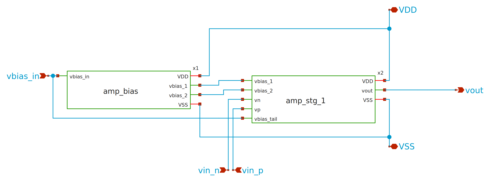
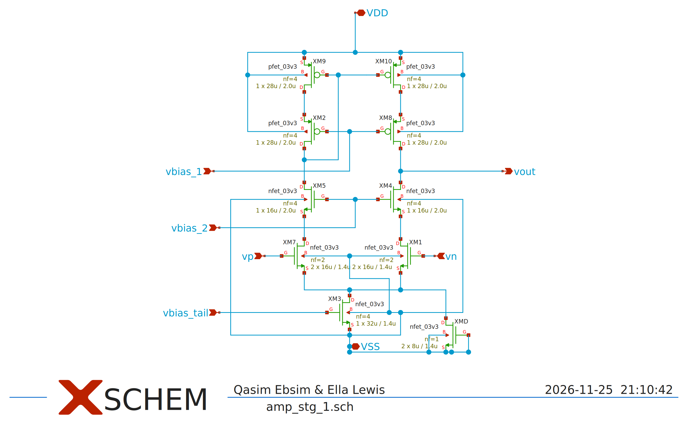
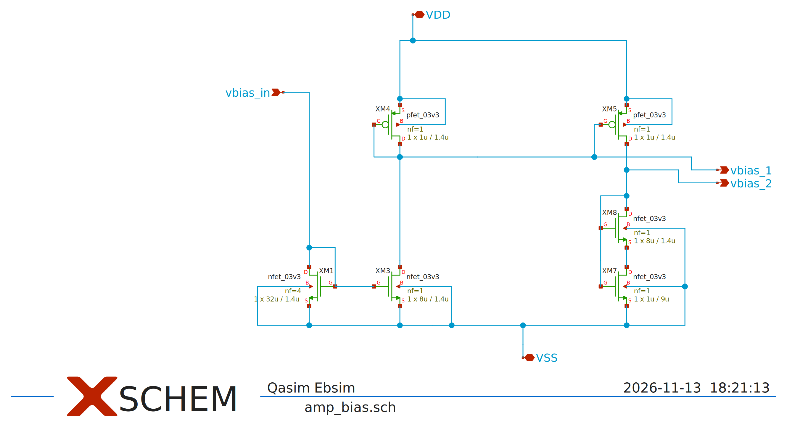

<!---
Tiny Tapeout Project Datasheet Documentation
Project: Telescopic Cascode Operational Amplifier
Target: GlobalFoundries 180nm CMOS (GF180MCU 3.3V)
Course: ECE298A
Authors: Qasim Ebsim, Ella Lewis
-->

## How it works

This project implements a single-stage **telescopic cascode operational amplifier** (`amp_stg_1`) paired with an integrated **self-biased cascode reference network** (`amp_bias`) in the GlobalFoundries GF180MCU 3.3 V CMOS process (`gf180mcuD`).

### Circuit Architecture

1. **Amplifier Core (`amp_stg_1`)**:
   - **Common-Centroid Input Pair**: NMOS differential pair (`XM1`, `XM7`, $W/L = 32\,\mu\text{m}/1.4\,\mu\text{m}$ with dummy edge devices `XMD`) centered around $V_{cm} \approx 1.2\text{ V}$.
   - **Telescopic Cascode Stage**: Long-channel NMOS (`XM4`, `XM5`, $16\,\mu\text{m}/2.0\,\mu\text{m}$) and PMOS (`XM2`, `XM8`, $28\,\mu\text{m}/2.0\,\mu\text{m}$) cascodes boost output impedance ($R_{out} \approx (g_{m,n} r_{o,n}^2) \parallel (g_{m,p} r_{o,p}^2)$) to achieve $>100\text{ dB}$ gain with a single dominant pole at `vout`.
   - **Active Load Mirror**: PMOS current mirror (`XM9`, `XM10`, $28\,\mu\text{m}/2.0\,\mu\text{m}$) performs differential-to-single-ended conversion.

2. **Bias Generation Network (`amp_bias`)**:
   - Accepts a single external $30\,\mu\text{A}$ reference current into `vbias_in` (`ua[3]`), mirrored $1{:}1$ into the amplifier tail (`XM3`).
   - A $4{:}1$ ratioed current mirror (`XM1` $\rightarrow$ `XM3`) and PMOS stack (`XM4`, `XM5`) generate `vbias_1`, while a diode-connected NMOS (`XM8`) stacked above a deep-triode long-channel FET (`XM7`, $1\,\mu\text{m}/9.0\,\mu\text{m}$) creates `vbias_2` with clean headroom across PVT corners.

### Physical Layout & Power Delivery

- **Power Grid & Decoupling**: Unified slotted `M4` (`VDPWR`) and `M3` (`VGND`) planes tied into the canonical TinyTapeout power spines, backed by $12.07\text{ pF}$ of MOS decoupling capacitors, a $0.52\text{ pF}$ `M1–M4` MOM capacitor, and $4.71\text{ pF}$ of distributed inter-metal plane capacitance.
- **Core Matching & Signal Integrity**: Common-centroid `10`-finger input pair (`D - P - N N - P P - N N - P - D`), mirror-symmetric core routing, symmetric `vin_p`/`vin_n` differential corridors, and redundant dual `via2` transitions.

---

### Key Specifications (Full-Layout RC PEX, $3.3\text{ V}$, $27^\circ\text{C}$, $C_L = 2\text{ pF}$)

| Parameter | Value | Condition / Notes |
| :--- | :---: | :--- |
| **Technology** | GF180MCU 3.3 V CMOS | `gf180mcuD` (`M1–M4` used) |
| **Supply Voltage ($V_{DD}$)** | $3.3\text{ V}$ | Nominal `VDPWR` supply |
| **Open-Loop DC Gain ($A_0$)** | **$102.06\text{ dB}$** | Ideal: $102.43\text{ dB}$ |
| **Unity-Gain Bandwidth ($\text{GBW}$)** | **$16.93\text{ MHz}$** | $C_L = 2\text{ pF}$ |
| **Phase Margin ($\text{PM}$)** | **$70.59^\circ$** | Critically damped (`0.08%` overshoot) |
| **CMRR / PSRR+ @ DC** | **$107.5\text{ dB}$ / $104.2\text{ dB}$** | — |
| **Input Offset ($V_{os}$, 100-Run MC)** | **$+0.18\text{ mV}$ ($\sigma = 1.07\text{ mV}$)** | $\pm 3\sigma = \pm 3.21\text{ mV}$ |
| **Slew Rate (Rise / Fall)** | **$11.87\text{ / }10.77\text{ V/}\mu\text{s}$** | $0.90\text{ V} \to 1.25\text{ V}$ large-signal step |
| **Quiescent Current / Power** | **$149.68\,\mu\text{A}$ / $0.494\text{ mW}$** | $I_{ref} = 30\,\mu\text{A}$ |
| **Layout Footprint** | $1 \times 2\text{ Tile}$ | TinyTapeout analog macro ($346.64 \times 325.36\,\mu\text{m}$) |

---

### Pinout Mapping

| Pin Name | Direction | Signal | Function |
| :--- | :---: | :---: | :--- |
| `ua[0]` | Input | `vin_p` | Non-inverting analog input ($V_{cm} \approx 1.2\text{ V}$) |
| `ua[1]` | Input | `vin_n` | Inverting analog input |
| `ua[2]` | Output | `vout` | Single-ended analog output |
| `ua[3]` | Input | `vbias_in` | Reference current input ($30\,\mu\text{A}$ nominal) |
| `VDPWR` | Power | `VDD` | $3.3\text{ V}$ analog core power supply |
| `VGND` | Ground | `VSS` | $0\text{ V}$ ground return |

*Note: Unused digital pins (`ui_in`, `uo_out`, `uio`) are tied internally to ground.*

---

## How to test

### 1. Power Supply and Biasing Setup
1. Connect `VGND` to clean bench ground ($0\text{ V}$) and `VDPWR` to a low-noise $3.3\text{ V}$ power supply.
2. Source $30\,\mu\text{A}$ into `ua[3]` (`vbias_in`) using a precision current source (or an external $\approx 84.5\text{ k}\Omega$ $0.1\%$ resistor from `VDPWR` to `ua[3]`).

### 2. Unity-Gain Buffer Test (Functional Verification)
1. Tie `ua[2]` (`vout`) externally to `ua[1]` (`vin_n`) for unity-gain feedback.
2. Sweep `ua[0]` (`vin_p`) around $1.0\text{ V}$ to $1.5\text{ V}$ and verify linear tracking within $\pm 5\text{ mV}$.
3. Apply a $50\text{ mV}$ step centered at $1.2\text{ V}$ DC on `vin_p` and observe `vout` with a low-capacitance active/10× probe to verify fast settling ($\approx 28.7\text{ ns}$ at $2\text{ pF}$) without ringing.

### 3. Open-Loop AC & Closed-Loop Gain Characterization
1. Configure a closed-loop inverting or non-inverting amplifier using external precision resistors (e.g., $R_1 = 10\text{ k}\Omega$, $R_2 = 100\text{ k}\Omega$ for $A_v = 10$).
2. Measure the $-3\text{ dB}$ closed-loop bandwidth and confirm gain-bandwidth product ($\text{GBW} \approx 16.9\text{ MHz}$ at $2\text{ pF}$ load).

---

## External hardware

1. **Power Supply**: Low-noise $3.3\text{ V}$ DC bench supply.
2. **Current Reference**: Precision DC current source set to $30\,\mu\text{A}$ (or $84.5\text{ k}\Omega$, $0.1\%$ metal-film resistor tied to $V_{DD}$).
3. **Signal Generator**: Arbitrary waveform generator supporting a $1.2\text{ V}_{DC}$ common-mode offset.
4. **Oscilloscope**: $>100\text{ MHz}$ scope with low-capacitance high-impedance probes ($\le 10\text{ pF}$).
5. **Breakout Board**: Standard TinyTapeout analog carrier board wired to `ua[0..3]`.
